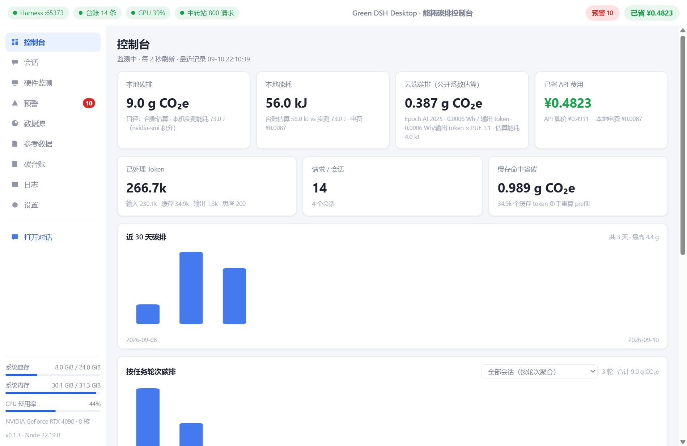
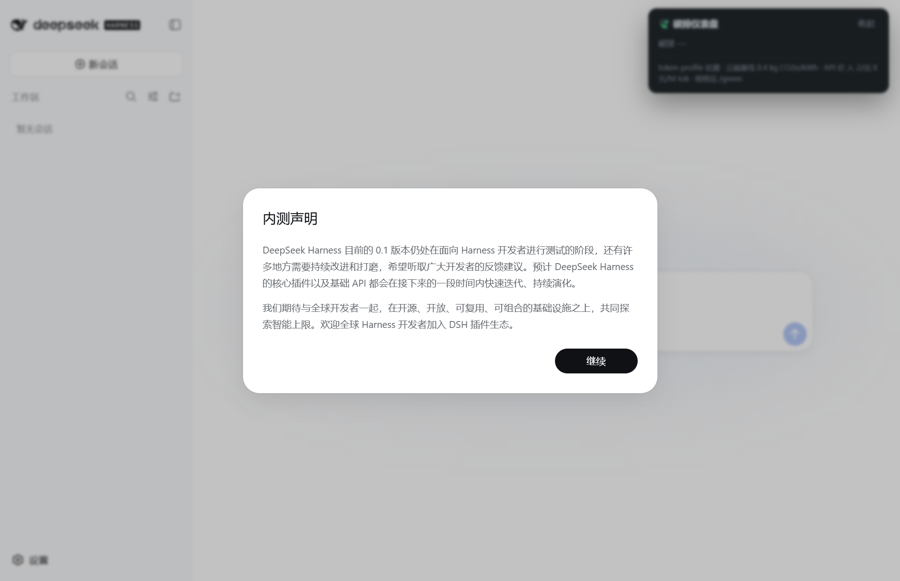
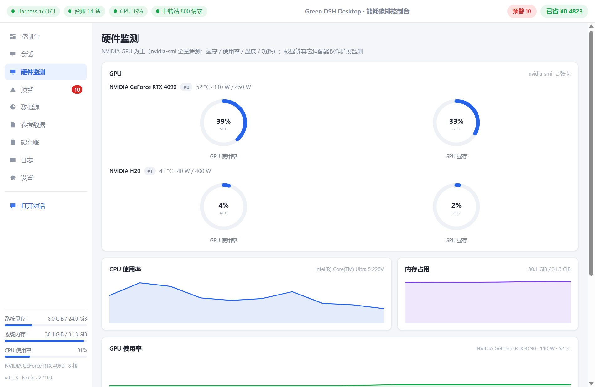
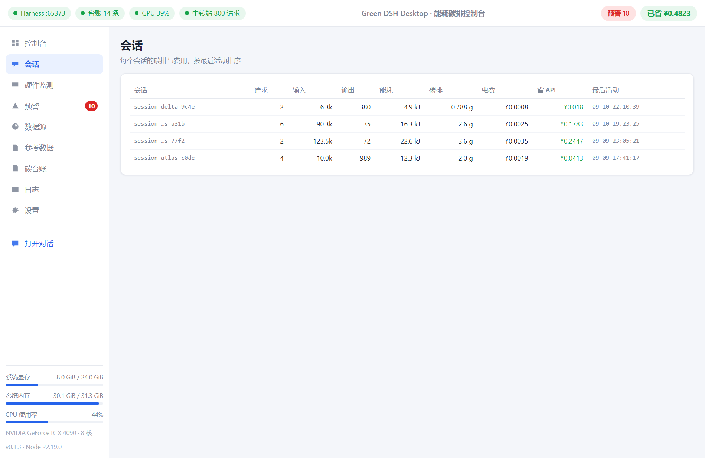
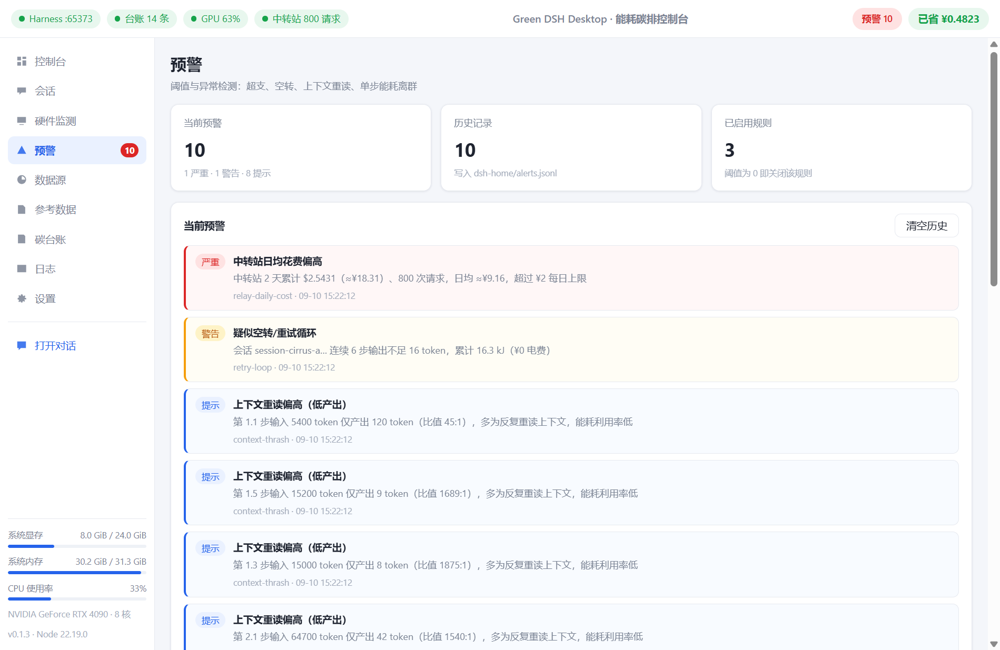
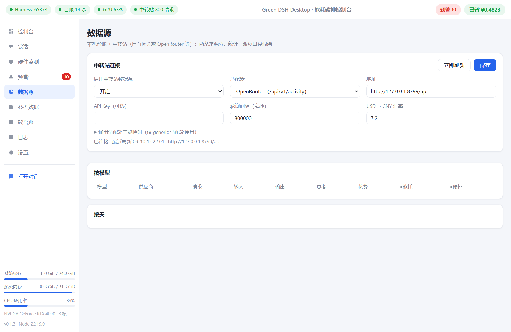

# Green DSH Desktop

**An open-source desktop app for DeepSeek Harness (DSH): use AI as usual, and see exactly how much electricity, carbon, and money every conversation costs.**

Whether you run local models or cloud APIs (DeepSeek / OpenRouter / your own gateway…), it accounts for the energy, carbon, and cost of every request, keeps them visible, and warns you when things get expensive.

中文 · [English](README.en.md)

---

## What it does

### 1. A DSH desktop app that just works

- Ships with a bundled Node.js 24 runtime and the full DSH distribution — **install and run**, no Node / pnpm / Python needed;
- The complete DSH chat experience: model management, sessions, tool calls, skills, subagents, workflows;
- Windows installer + portable zip.

### 2. The energy / carbon console (main window)

| Page | What you see |
| --- | --- |
| **Console** | Local carbon, local energy (estimate and measurement side by side), cloud carbon (published-coefficient estimate), API cost saved; **last-30-days** and **per-task-turn** carbon bar charts; live hardware rings |
| **Sessions** | Tokens, energy, carbon, electricity cost, and API savings per session |
| **Hardware** | Full NVIDIA telemetry (VRAM / utilization / temperature / power, **multi-GPU**); integrated GPUs as an extension; CPU / memory curves |
| **Alerts** | Overspend and anomaly warnings, see below |
| **Data sources** | Connect OpenRouter or your own relay to pull **actual spend** and token usage |
| **Reference data** | Every coefficient with its source and year, all verifiable |
| **Ledger** | Per-step JSONL detail with a measured-energy column, one-click CSV export |
| **Logs / Settings** | Harness output; baseline settings for grid intensity / electricity price / API prices |

### 3. Two accounting paths (the core design)

- **Local models → measured**: when an NVIDIA GPU is present, power is sampled continuously and integrated into **real energy**, attributed to each request step by time; a one-click calibration derives your machine's own J/token per model;
- **Cloud APIs → published coefficients**: the cloud only exposes tokens, so the token→energy relation always uses **published, authoritative coefficients** (never a local calibration projected onto the cloud).

### 4. Alerts: know when you're burning money and carbon

- **Thresholds**: per-session energy / cost, rolling 1-hour / 24-hour cost, relay daily average;
- **Anomalies**: per-step energy outliers (robust z-score), **context thrash** (huge input-to-output ratio — re-reading context with no useful output), **retry loops** (many steps with almost no output), low cache-hit rate;
- Critical alerts also raise a **desktop notification**.

### 5. In-chat dashboard

A carbon card pinned to the top-right of the chat window: session carbon / energy / electricity cost, API cost saved, local-vs-cloud comparison, per-turn energy bars, and all-session totals.

### 6. Local small-model support out of the box

Ships with a Qwen2.5-0.5B (CPU inference) launcher script and provider config — one command starts the server and you get the full "local model + measured accounting" loop; swap in a bigger model by changing one path.

---

## Screenshots

| Console overview | In-chat dashboard |
| --- | --- |
|  |  |

| Hardware (multi-GPU NVIDIA) | Alerts |
| --- | --- |
|  |  |

| Sessions | Data sources (relay) |
| --- | --- |
|  |  |

| Reference data (coefficients & sources) | Ledger detail |
| --- | --- |
|  |  |

---

## Download & install

Grab from [Releases](../../releases):

| File | Notes |
| --- | --- |
| `Green DSH Desktop Setup x.x.x.exe` | Windows installer (chooseable install dir, desktop shortcut) |
| `Green DSH Desktop-x.x.x-win.zip` | Portable build — unzip and run |

> The installer is unsigned, so SmartScreen will interrupt the first launch: **More info → Run anyway**.
> Upgrades keep your sessions / credentials / ledger / settings automatically.

## Quick start (three steps)

1. **Install and open** — first run helps you configure a model (paste an API key in the DSH settings page, or use a local model);
2. **Click "Open Chat" and work** — chat and code as usual, nothing else to change;
3. **Back to the console** — carbon, energy, cost, per-turn chart, and hardware curves refresh live; tune electricity price / API prices / grid intensity in Settings so the numbers match your reality.

To try a local model:

```powershell
powershell -ExecutionPolicy Bypass -File scripts\start-local-model.ps1
```

then pick "本地 llama.cpp（Qwen2.5-0.5B）" in the app (download the model first — see the notes inside the script).

---

## Data & method (in short)

- **Local**: token usage → calibration coefficients → energy (measurement wins when an NVIDIA GPU is present) → grid carbon intensity → carbon;
- **Cloud**: token usage → **published coefficients** → energy → carbon;
- **Cost**: API list price vs local electricity.

Every coefficient carries its source and year:

| Category | Value | Source |
| --- | --- | --- |
| China grid | 0.5777 kgCO₂e/kWh (2024) | MEE, 2024 power carbon footprint factor |
| US grid | 0.3497 kgCO₂e/kWh | US EPA eGRID 2023 |
| Cloud per-token | 0.0006 Wh / output token | Epoch AI 2025 |
| Cloud per-request | 0.24 Wh / 0.03 gCO₂e | Google Cloud, 2025-08-21 |
| Local calibration | H20 request-level fit (R² ≥ 0.998) | this project's experiments |

**Honest boundaries**: without GPU measurement, local figures are token-profile estimates rather than hardware measurements; cloud figures are estimates from published coefficients, not vendor measurements; carbon = energy × grid intensity is an engineering estimate, not certified accounting.

---

## Build from source

```bash
git clone <this repo>
cd green-dsh-desktop
npm install

# 1) Pack the green-meter / dashboard plugins (needs a DSH source checkout; set DSH_CHECKOUT to point at it)
npm run vendor:plugins

# 2) Assemble the bundled harness (npm-installs the DSH distribution plus local plugins)
npm run pack:harness

# 3) Drop in the Node runtime (copy your node.exe into resources/runtime/)

# 4) Run / package
npm start
npm run dist
```

---

## Limitations

- Developed and verified on Windows; Electron is cross-platform but macOS / Linux build paths are unverified;
- Local measurement relies on nvidia-smi (NVIDIA GPUs); without one, local figures fall back to estimates and integrated GPUs are monitored as an extension (utilization only);
- App data (sessions / credentials / ledger) lives in `resources/harness/dsh-home` inside the install directory — back it up before uninstalling (upgrades preserve it automatically).

## Credits

- [DeepSeek Harness](https://github.com/deepseek-ai/deepseek-harness) and [Cordis](https://github.com/cordiverse/cordis) — this app is a plugin-based desktop distribution of DSH;
- green-meter (this project's energy-accounting plugin) provides the token-profile calibration;
- [llama.cpp](https://github.com/ggml-org/llama.cpp) — local inference;
- [Electron](https://www.electronjs.org/) — the desktop shell;
- Energy / carbon reference data from published disclosures by MEE (China), US EPA eGRID, Epoch AI, and Google Cloud.

## License

MIT
